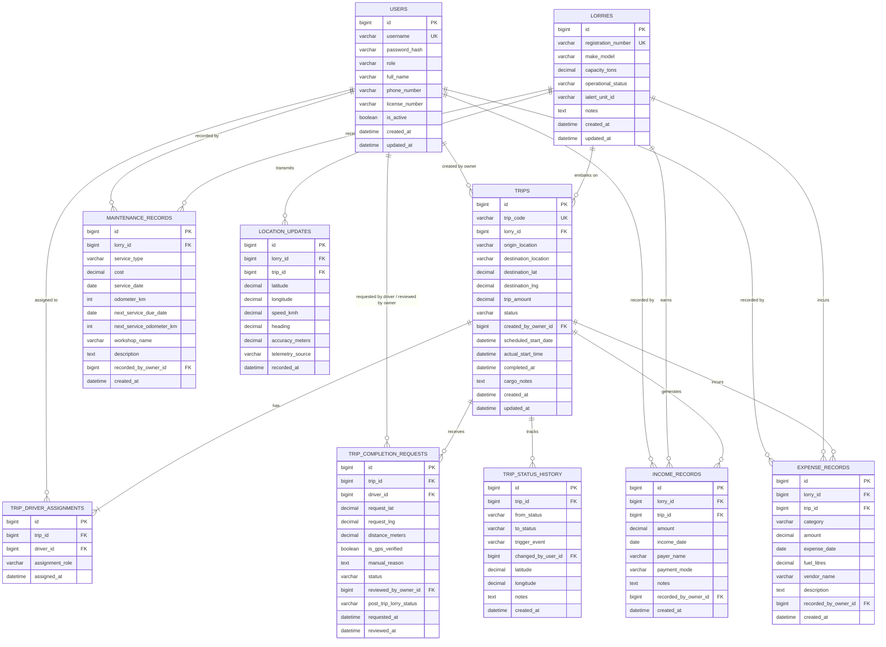

# Database Architecture & Relational Schema Design

**Document ID:** LFM-DOC-008  
**Version:** 1.0.0 (Stage 1 Design)  
**Status:** DRAFT - PENDING OWNER REVIEW  
**Last Updated:** 2026-10-24  

---

## 1. Schema Overview & Database Standards

The system utilizes **MySQL Server 8.4 LTS** with the database schema named **`lorry_fleet_db`**.

* **Encoding:** `utf8mb4` (Full 4-byte UTF-8, supporting multilingual text and emoji characters)
* **Collation:** `utf8mb4_unicode_ci` (Accurate multilingual sorting and case-insensitive matching)
* **Storage Engine:** `InnoDB` (ACID compliance, row-level locking, foreign key constraints)
* **Schema Evolution Strategy:** Strict schema validation (`spring.jpa.hibernate.ddl-auto: validate`).  
  > [!IMPORTANT]
  > In accordance with Stage 1 constraints, **no tables are created or modified in the database during this stage**. All table definitions documented herein are planned for controlled deployment in Stage 2 via versioned SQL migration scripts.

---

## 2. Entity Relationship Diagram (ERD)



---

## 3. Relational Table Specifications

### 3.1 `users` Table
Stores authentication credentials and profiles for both Owners and Drivers.
```sql
CREATE TABLE users (
    id BIGINT AUTO_INCREMENT PRIMARY KEY,
    username VARCHAR(50) NOT NULL UNIQUE,
    password_hash VARCHAR(255) NOT NULL,
    role VARCHAR(20) NOT NULL, -- 'OWNER', 'DRIVER'
    full_name VARCHAR(100) NOT NULL,
    phone_number VARCHAR(20),
    license_number VARCHAR(50),
    is_active BOOLEAN NOT NULL DEFAULT TRUE,
    created_at TIMESTAMP NOT NULL DEFAULT CURRENT_TIMESTAMP,
    updated_at TIMESTAMP NOT NULL DEFAULT CURRENT_TIMESTAMP ON UPDATE CURRENT_TIMESTAMP,
    INDEX idx_users_role (role),
    INDEX idx_users_active (is_active)
) ENGINE=InnoDB DEFAULT CHARSET=utf8mb4 COLLATE=utf8mb4_unicode_ci;
```

### 3.2 `lorries` Table
Stores fleet commercial vehicle assets and their independent operational states.
```sql
CREATE TABLE lorries (
    id BIGINT AUTO_INCREMENT PRIMARY KEY,
    registration_number VARCHAR(20) NOT NULL UNIQUE, -- e.g. 'AP 26 XX 1234'
    make_model VARCHAR(100) NOT NULL, -- e.g. 'Ashok Leyland 2820 HG'
    capacity_tons DECIMAL(5,2) NOT NULL, -- e.g. 20.50
    operational_status VARCHAR(25) NOT NULL DEFAULT 'AVAILABLE', -- 'AVAILABLE', 'ON_TRIP', 'MAINTENANCE', 'UNAVAILABLE'
    ialert_unit_id VARCHAR(50), -- Telematics device identifier
    notes TEXT,
    created_at TIMESTAMP NOT NULL DEFAULT CURRENT_TIMESTAMP,
    updated_at TIMESTAMP NOT NULL DEFAULT CURRENT_TIMESTAMP ON UPDATE CURRENT_TIMESTAMP,
    INDEX idx_lorries_status (operational_status)
) ENGINE=InnoDB DEFAULT CHARSET=utf8mb4 COLLATE=utf8mb4_unicode_ci;
```

### 3.3 `trips` Table
Stores freight trips, scheduled routes, status, and confidential commercial pricing.
```sql
CREATE TABLE trips (
    id BIGINT AUTO_INCREMENT PRIMARY KEY,
    trip_code VARCHAR(30) NOT NULL UNIQUE, -- e.g. 'TRP-2026-0001'
    lorry_id BIGINT NOT NULL,
    origin_location VARCHAR(150) NOT NULL,
    destination_location VARCHAR(150) NOT NULL,
    destination_lat DECIMAL(10,7) NOT NULL,
    destination_lng DECIMAL(10,7) NOT NULL,
    trip_amount DECIMAL(12,2) NOT NULL, -- Confidential freight rate (in INR)
    status VARCHAR(30) NOT NULL DEFAULT 'ASSIGNED', -- 'ASSIGNED', 'IN_PROGRESS', 'AWAITING_OWNER_CONFIRMATION', 'COMPLETED', 'CANCELLED'
    created_by_owner_id BIGINT NOT NULL,
    scheduled_start_date DATETIME NOT NULL,
    actual_start_time DATETIME,
    completed_at DATETIME,
    cargo_notes TEXT,
    created_at TIMESTAMP NOT NULL DEFAULT CURRENT_TIMESTAMP,
    updated_at TIMESTAMP NOT NULL DEFAULT CURRENT_TIMESTAMP ON UPDATE CURRENT_TIMESTAMP,
    CONSTRAINT fk_trips_lorry FOREIGN KEY (lorry_id) REFERENCES lorries(id) ON DELETE RESTRICT,
    CONSTRAINT fk_trips_owner FOREIGN KEY (created_by_owner_id) REFERENCES users(id) ON DELETE RESTRICT,
    INDEX idx_trips_status (status),
    INDEX idx_trips_lorry (lorry_id)
) ENGINE=InnoDB DEFAULT CHARSET=utf8mb4 COLLATE=utf8mb4_unicode_ci;
```

### 3.4 `trip_driver_assignments` Table
Enables multi-driver support per trip (primary driver and optional relief drivers).
```sql
CREATE TABLE trip_driver_assignments (
    id BIGINT AUTO_INCREMENT PRIMARY KEY,
    trip_id BIGINT NOT NULL,
    driver_id BIGINT NOT NULL,
    assignment_role VARCHAR(20) NOT NULL DEFAULT 'PRIMARY', -- 'PRIMARY', 'CO_DRIVER'
    assigned_at TIMESTAMP NOT NULL DEFAULT CURRENT_TIMESTAMP,
    CONSTRAINT fk_tda_trip FOREIGN KEY (trip_id) REFERENCES trips(id) ON DELETE CASCADE,
    CONSTRAINT fk_tda_driver FOREIGN KEY (driver_id) REFERENCES users(id) ON DELETE RESTRICT,
    UNIQUE KEY uq_trip_driver (trip_id, driver_id),
    INDEX idx_tda_driver (driver_id)
) ENGINE=InnoDB DEFAULT CHARSET=utf8mb4 COLLATE=utf8mb4_unicode_ci;
```

### 3.5 `trip_completion_requests` Table
Audit table capturing the 500m geofence arrival check or manual review fallback.
```sql
CREATE TABLE trip_completion_requests (
    id BIGINT AUTO_INCREMENT PRIMARY KEY,
    trip_id BIGINT NOT NULL,
    driver_id BIGINT NOT NULL,
    request_lat DECIMAL(10,7),
    request_lng DECIMAL(10,7),
    distance_meters DECIMAL(8,2),
    is_gps_verified BOOLEAN NOT NULL DEFAULT FALSE,
    manual_reason TEXT,
    status VARCHAR(20) NOT NULL DEFAULT 'PENDING', -- 'PENDING', 'APPROVED', 'REJECTED'
    reviewed_by_owner_id BIGINT,
    post_trip_lorry_status VARCHAR(25), -- 'AVAILABLE', 'MAINTENANCE', 'UNAVAILABLE'
    requested_at TIMESTAMP NOT NULL DEFAULT CURRENT_TIMESTAMP,
    reviewed_at TIMESTAMP NULL,
    CONSTRAINT fk_tcr_trip FOREIGN KEY (trip_id) REFERENCES trips(id) ON DELETE CASCADE,
    CONSTRAINT fk_tcr_driver FOREIGN KEY (driver_id) REFERENCES users(id) ON DELETE RESTRICT,
    CONSTRAINT fk_tcr_owner FOREIGN KEY (reviewed_by_owner_id) REFERENCES users(id) ON DELETE RESTRICT
) ENGINE=InnoDB DEFAULT CHARSET=utf8mb4 COLLATE=utf8mb4_unicode_ci;
```

### 3.6 `trip_status_history` Table
Immutable chronological state history for operational tracking and dispute audit.
```sql
CREATE TABLE trip_status_history (
    id BIGINT AUTO_INCREMENT PRIMARY KEY,
    trip_id BIGINT NOT NULL,
    from_status VARCHAR(30),
    to_status VARCHAR(30) NOT NULL,
    trigger_event VARCHAR(50) NOT NULL,
    changed_by_user_id BIGINT NOT NULL,
    latitude DECIMAL(10,7),
    longitude DECIMAL(10,7),
    notes TEXT,
    created_at TIMESTAMP NOT NULL DEFAULT CURRENT_TIMESTAMP,
    CONSTRAINT fk_tsh_trip FOREIGN KEY (trip_id) REFERENCES trips(id) ON DELETE CASCADE,
    CONSTRAINT fk_tsh_user FOREIGN KEY (changed_by_user_id) REFERENCES users(id) ON DELETE RESTRICT,
    INDEX idx_tsh_trip (trip_id)
) ENGINE=InnoDB DEFAULT CHARSET=utf8mb4 COLLATE=utf8mb4_unicode_ci;
```

### 3.7 `income_records` Table (Owner-Only)
Stores freight revenue received by the fleet.
```sql
CREATE TABLE income_records (
    id BIGINT AUTO_INCREMENT PRIMARY KEY,
    lorry_id BIGINT NOT NULL,
    trip_id BIGINT NULL,
    amount DECIMAL(12,2) NOT NULL,
    income_date DATE NOT NULL,
    payer_name VARCHAR(100),
    payment_mode VARCHAR(30), -- 'BANK_TRANSFER', 'CASH', 'CHEQUE', 'UPI'
    notes TEXT,
    recorded_by_owner_id BIGINT NOT NULL,
    created_at TIMESTAMP NOT NULL DEFAULT CURRENT_TIMESTAMP,
    updated_at TIMESTAMP NOT NULL DEFAULT CURRENT_TIMESTAMP ON UPDATE CURRENT_TIMESTAMP,
    CONSTRAINT fk_income_lorry FOREIGN KEY (lorry_id) REFERENCES lorries(id) ON DELETE RESTRICT,
    CONSTRAINT fk_income_trip FOREIGN KEY (trip_id) REFERENCES trips(id) ON DELETE SET NULL,
    CONSTRAINT fk_income_owner FOREIGN KEY (recorded_by_owner_id) REFERENCES users(id) ON DELETE RESTRICT,
    INDEX idx_income_date (income_date),
    INDEX idx_income_lorry (lorry_id)
) ENGINE=InnoDB DEFAULT CHARSET=utf8mb4 COLLATE=utf8mb4_unicode_ci;
```

### 3.8 `expense_records` Table (Owner-Only)
Categorized fleet operating expenses (Diesel, Toll, Tyres, Maintenance, Other).
```sql
CREATE TABLE expense_records (
    id BIGINT AUTO_INCREMENT PRIMARY KEY,
    lorry_id BIGINT NOT NULL,
    trip_id BIGINT NULL,
    category VARCHAR(30) NOT NULL, -- 'DIESEL', 'TOLL', 'REPAIRS', 'TYRES', 'SERVICING', 'OTHER'
    amount DECIMAL(12,2) NOT NULL,
    expense_date DATE NOT NULL,
    fuel_litres DECIMAL(6,2) NULL, -- Specifically for DIESEL
    vendor_name VARCHAR(100), -- Fuel station / tyre shop
    description TEXT,
    recorded_by_owner_id BIGINT NOT NULL,
    created_at TIMESTAMP NOT NULL DEFAULT CURRENT_TIMESTAMP,
    updated_at TIMESTAMP NOT NULL DEFAULT CURRENT_TIMESTAMP ON UPDATE CURRENT_TIMESTAMP,
    CONSTRAINT fk_expense_lorry FOREIGN KEY (lorry_id) REFERENCES lorries(id) ON DELETE RESTRICT,
    CONSTRAINT fk_expense_trip FOREIGN KEY (trip_id) REFERENCES trips(id) ON DELETE SET NULL,
    CONSTRAINT fk_expense_owner FOREIGN KEY (recorded_by_owner_id) REFERENCES users(id) ON DELETE RESTRICT,
    INDEX idx_expense_date (expense_date),
    INDEX idx_expense_category (category),
    INDEX idx_expense_lorry (lorry_id)
) ENGINE=InnoDB DEFAULT CHARSET=utf8mb4 COLLATE=utf8mb4_unicode_ci;
```

### 3.9 `maintenance_records` Table (Owner-Only)
Major workshop service history and preventive maintenance milestones.
```sql
CREATE TABLE maintenance_records (
    id BIGINT AUTO_INCREMENT PRIMARY KEY,
    lorry_id BIGINT NOT NULL,
    service_type VARCHAR(50) NOT NULL, -- 'ROUTINE_SERVICE', 'OIL_CHANGE', 'TYRE_REPLACEMENT', 'MAJOR_OVERHAUL'
    cost DECIMAL(12,2) NOT NULL,
    service_date DATE NOT NULL,
    odometer_km INT,
    next_service_due_date DATE,
    next_service_odometer_km INT,
    workshop_name VARCHAR(150),
    description TEXT,
    recorded_by_owner_id BIGINT NOT NULL,
    created_at TIMESTAMP NOT NULL DEFAULT CURRENT_TIMESTAMP,
    updated_at TIMESTAMP NOT NULL DEFAULT CURRENT_TIMESTAMP ON UPDATE CURRENT_TIMESTAMP,
    CONSTRAINT fk_maint_lorry FOREIGN KEY (lorry_id) REFERENCES lorries(id) ON DELETE RESTRICT,
    CONSTRAINT fk_maint_owner FOREIGN KEY (recorded_by_owner_id) REFERENCES users(id) ON DELETE RESTRICT,
    INDEX idx_maint_lorry (lorry_id),
    INDEX idx_maint_date (service_date)
) ENGINE=InnoDB DEFAULT CHARSET=utf8mb4 COLLATE=utf8mb4_unicode_ci;
```

### 3.10 `location_updates` Table
Telemetry points captured from iALERT API or driver mobile GPS.
```sql
CREATE TABLE location_updates (
    id BIGINT AUTO_INCREMENT PRIMARY KEY,
    lorry_id BIGINT NOT NULL,
    trip_id BIGINT NULL,
    latitude DECIMAL(10,7) NOT NULL,
    longitude DECIMAL(10,7) NOT NULL,
    speed_kmh DECIMAL(5,2),
    heading DECIMAL(5,2),
    accuracy_meters DECIMAL(6,2),
    telemetry_source VARCHAR(20) NOT NULL, -- 'IALERT', 'DRIVER_PHONE'
    recorded_at DATETIME NOT NULL,
    created_at TIMESTAMP NOT NULL DEFAULT CURRENT_TIMESTAMP,
    CONSTRAINT fk_loc_lorry FOREIGN KEY (lorry_id) REFERENCES lorries(id) ON DELETE CASCADE,
    CONSTRAINT fk_loc_trip FOREIGN KEY (trip_id) REFERENCES trips(id) ON DELETE SET NULL,
    INDEX idx_loc_lorry_time (lorry_id, recorded_at)
) ENGINE=InnoDB DEFAULT CHARSET=utf8mb4 COLLATE=utf8mb4_unicode_ci;
```
