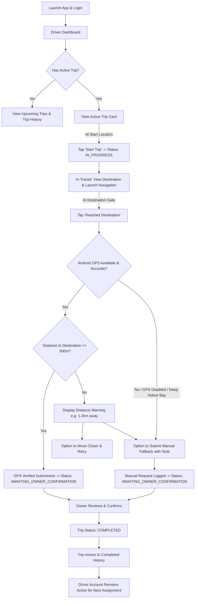

# Driver Operational Workflows

**Document ID:** LFM-DOC-005  
**Version:** 1.0.0 (Stage 1 Design)  
**Status:** DRAFT - PENDING OWNER REVIEW  
**Last Updated:** 2026-10-24  

---

## 1. Overview

The Driver interface is designed specifically for commercial lorry drivers operating in varied on-road conditions. The design emphasizes high readability, large touch targets, minimal textual typing, zero exposure to commercial financials, and intuitive arrival verification.



---

## 2. Step-by-Step Driver User Journeys

### Journey 1: Authentication with Permanent Credentials
1. **Launch App:** Driver opens the Lorry Fleet Manager application.
2. **Input Credentials:** Driver enters permanent username (provided by Owner during onboarding) and password.
3. **Remember Me:** App persists session securely via Android Keystore-backed tokens; driver does not have to re-enter credentials on every app open.
4. **Permanent Account Assurance:** The driver is assured that their credentials are tied to their permanent profile and driving history.

---

### Journey 2: Dashboard Navigation & Trip Visibility
The Driver Dashboard is organized into three clean sections:

1. **Active Trip Banner / Card (Top Priority):**
   - Visible only when the driver is actively assigned to an ongoing or scheduled trip.
   - Displays: Lorry Registration Number (e.g., `AP 26 XX 1234`), Origin City, Destination City, Current Status badge (`ASSIGNED`, `IN_PROGRESS`, or `AWAITING_OWNER_CONFIRMATION`), and Departure Date.
   - **Financial Privacy Invariant:** Freight rates, revenue, and billing terms are **never** rendered on this card or in any driver sub-view.
2. **Upcoming Assigned Trips:**
   - Displays upcoming trips assigned by the Owner that have not yet started.
   - Allows the driver to plan rest breaks and route familiarity in advance.
3. **Completed Trip History:**
   - Paginated list of past completed trips performed by this driver.
   - Read-only historical audit showing dates, lorry used, and origin/destination.

---

### Journey 3: Trip Commencement (`ASSIGNED` $\rightarrow$ `IN_PROGRESS`)
1. **Physical Inspection:** Driver arrives at depot, verifies assigned lorry condition and cargo loading.
2. **Open Trip Details:** Driver taps the Active Trip card.
3. **Permission Check:** If location permission has not yet been granted, the app prompts for Android runtime location permission (`ACCESS_FINE_LOCATION`) with an explanation that location is needed to verify destination arrival.
4. **Trigger Start:** Driver taps **"Start Trip / Depart"**.
5. **Confirmation:** System confirms departure timestamp and updates trip status to `IN_PROGRESS`.
6. **Navigation Shortcut:** Driver can tap **"Open in Google Maps"** which sends an Android navigation intent:
   ```kotlin
   val gmmIntentUri = Uri.parse("google.navigation:q=${destinationLat},${destinationLng}")
   val mapIntent = Intent(Intent.ACTION_VIEW, gmmIntentUri)
   ```

---

### Journey 4: Geofenced Arrival Verification & "Reached Destination"
When the vehicle reaches the consignee's delivery warehouse or destination yard:

1. **Trigger Action:** Driver opens the app and taps the prominent green button: **"Reached Destination"**.
2. **Automated GPS Verification Engine:**
   - The app queries the Android `FusedLocationProviderClient` for high-accuracy current location.
   - **Quality Assurance Filters:**
     * *Freshness Check:* Timestamp must be within the last 180 seconds.
     * *Accuracy Check:* Horizontal accuracy radius must be $\le 100\text{ metres}$.
   - App transmits coordinates to backend endpoint `POST /api/driver/trips/{id}/reached-destination`.
3. **Backend Geofence Calculation:**
   - Backend evaluates distance using the Haversine equation:
     $$d = 2r \arcsin\left(\sqrt{\sin^2\left(\frac{\Delta \phi}{2}\right) + \cos(\phi_1)\cos(\phi_2)\sin^2\left(\frac{\Delta \lambda}{2}\right)}\right)$$
   - Destination threshold: **500 metres**.
4. **Outcome Paths:**
   - **Case A: Within 500m Radius (Verified Success):**
     * Trip transitions to `AWAITING_OWNER_CONFIRMATION`.
     * UI confirms: *"Destination arrival verified by GPS! Request submitted to Fleet Owner for confirmation."*
     * Arrival button is disabled to prevent duplicate transmissions.
   - **Case B: Outside 500m Radius (Geofence Mismatch):**
     * System displays an informational warning dialog:
       > **"Destination Not Detected"**  
       > You are currently **1.4 km** away from the designated delivery location. Please ensure you are at the correct delivery gate or warehouse before retrying.
     * Options presented:
       1. **"Retry GPS Check"** (driver moves vehicle closer to gate).
       2. **"Submit for Manual Review"** (moves to Case C).
   - **Case C: Manual Review Fallback (GPS Unavailable / Dead-zone):**
     * Applicable if unloading occurs inside a covered metal shed, GPS receiver fails, or the unloading yard is outside geocoded pin.
     * Driver taps **"Submit Manual Arrival"**.
     * Mandatory text field: Driver inputs reason (e.g., *Security directed lorry to outer holding yard 800m before gate*).
     * Trip transitions to `AWAITING_OWNER_CONFIRMATION` flagged with `MANUAL_REVIEW_REQUIRED`.

---

### Journey 5: Post-Completion Transition & Driver Account Preservation
1. **Owner Confirmation:** The Owner receives the arrival request, reviews the verification audit trail, and confirms completion.
2. **State Transition:** The trip reaches `COMPLETED` status.
3. **Active Workflow Expiry:**
   - The active trip card disappears from the driver's active dashboard.
   - The completed trip immediately appears in **"Completed Trip History"**.
4. **Permanent Account Intact:**
   - The driver is **never logged out** or de-provisioned.
   - The driver's account remains active, ready to receive subsequent trip assignments from the Owner.

---

### Journey 6: Profile & Security Management
1. **View Profile:** Driver can inspect their registered name, mobile number, commercial driving license number, and total completed trips count.
2. **Password Change:** Driver can change their password at any time by providing current password and new password.
3. **Sign Out:** Driver can explicitly log out when changing shared devices.
