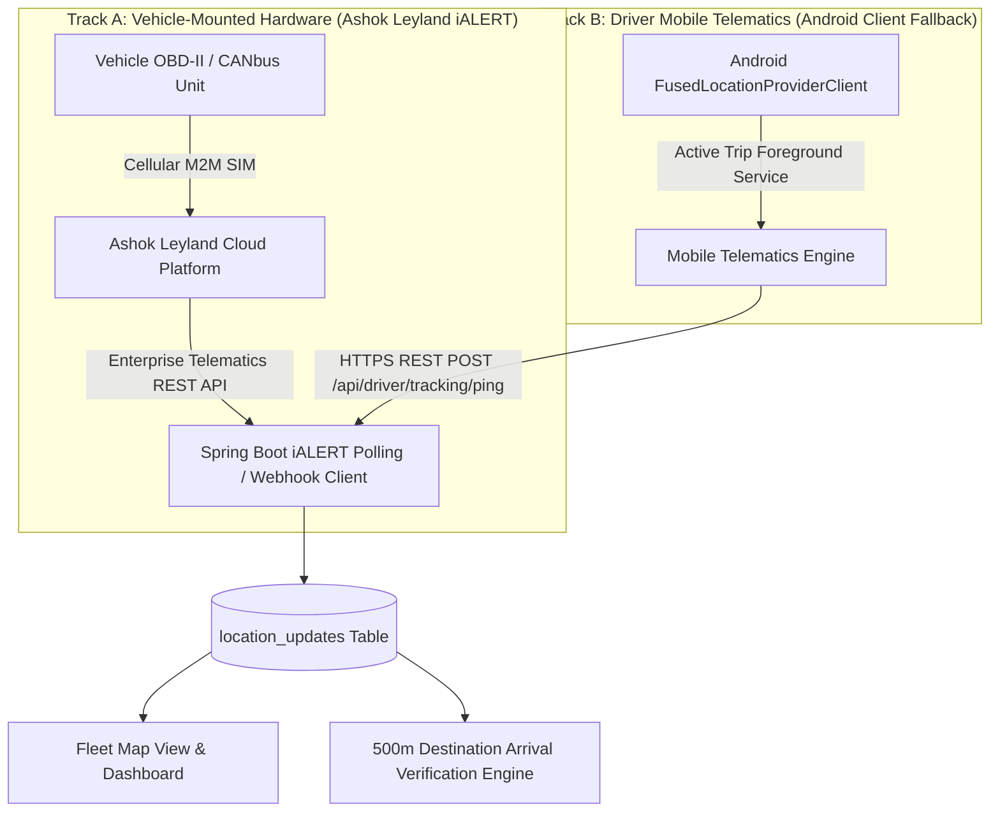

# GPS Telematics & Geofence Integration Plan

**Document ID:** LFM-DOC-010  
**Version:** 1.0.0 (Stage 1 Design)  
**Status:** DRAFT - PENDING OWNER REVIEW  
**Last Updated:** 2026-10-24  

---

## 1. Overview & Dual-Track Telematics Strategy

The system requires real-time vehicle visibility and automated destination verification for approximately 5 commercial lorries. The owner currently utilizes **Ashok Leyland iALERT** telematics hardware installed on the vehicles.

To ensure continuous project progress without blocking on external vendor negotiations, this architecture adopts a **Dual-Track Telematics Strategy**:
* **Track A (Primary):** Ashok Leyland iALERT Enterprise API Integration.
* **Track B (Fallback / Redundant):** Driver Smartphone Android Fused Location Provider.

---

## 2. Track A: Ashok Leyland iALERT Integration Discovery Checklist

> [!WARNING]
> It must **never be assumed** that Ashok Leyland iALERT APIs are publicly accessible, free of charge, or automatically enabled for vehicle owners. Many commercial telematics vendors require separate enterprise developer agreements, paid API tier add-ons, and formal NDA clearance.

The following discovery questions must be confirmed with Ashok Leyland before implementing Track A:

| Checklist Item | Description & Technical Impact | Client Action Required |
| :--- | :--- | :--- |
| **1. API Availability** | Does the owner's iALERT commercial contract include third-party API / webhook access, or is access restricted to Ashok Leyland's proprietary web/mobile portal? | Contact Ashok Leyland Fleet Account Manager or telematics support. |
| **2. Commercial Cost** | Are there additional monthly fees, setup costs, or data consumption billing per vehicle for API access? | Verify subscription terms and commercial quotation. |
| **3. Authorization Protocol** | Does the API authenticate via OAuth2 (Client Credentials grant), persistent API Key headers, or basic token exchange? | Request official API Integration Documentation & Sandbox Keys. |
| **4. Integration Mechanism** | Is telemetry retrieved via polling (e.g. querying `GET /fleet/vehicles/telemetry` every 60s) or event-driven webhooks pushed to our backend? | Determine server firewall and ingress endpoint needs. |
| **5. Update Frequency** | At what cadence does the on-vehicle hardware transmit data (e.g., every 10s, 30s, or only on ignition changes)? | Assess database ingestion volume and storage capacity. |
| **6. Available Telemetry Attributes** | Does the feed provide GPS coordinates, speed, heading, odometer, fuel level, engine status, and diagnostic fault codes (DTC)? | Map fields to our `location_updates` schema. |
| **7. Device Mapping** | What unique identifier maps vehicles to iALERT hardware (Chassis VIN, Vehicle Registration Number, or Telematics IMEI)? | Populate `lorries.ialert_unit_id` with this exact identifier. |

---

## 3. Track B: Driver Smartphone GPS Fallback Architecture

If Ashok Leyland API access is delayed, cost-prohibitive, or unavailable, Track B provides an immediate, fully functional alternative using the driver's Android smartphone.

### 3.1 Android Location Framework
* **Provider:** Google Play Services `FusedLocationProviderClient` (combines GPS, Wi-Fi, and cellular tower signals for optimal battery/accuracy balance).
* **Location Priority:** `Priority.PRIORITY_HIGH_ACCURACY` during arrival verification; `Priority.PRIORITY_BALANCED_POWER_ACCURACY` during long highway transit.
* **Update Interval:** In-transit updates every 5 minutes while moving, dropping to 15 minutes when stationary to conserve phone battery.

### 3.2 Foreground Service & Battery Optimization
* When a trip enters `IN_PROGRESS`, the app activates an Android Foreground Service displaying a persistent notification:
  > **Lorry Fleet Manager**  
  > Active Trip in progress (AP 26 XX 1234) — Trip tracking is active.
* This ensures the Android operating system does not kill the location task in Doze mode or low-memory conditions.

### 3.3 Driver Privacy & Strict Trip-Bound Tracking
* **Zero Off-Trip Tracking:** Location tracking runs **strictly and exclusively** while a trip is in `IN_PROGRESS` status.
* When a trip reaches `AWAITING_OWNER_CONFIRMATION` or `COMPLETED`, the foreground service **immediately halts**, and the location listener is unregistered.
* Drivers are never tracked off-duty, during rest periods, or between dispatches.

---

## 4. Destination Geofence Verification Subsystem (500-Metre Engine)

### 4.1 Geodetic Verification Standard
* **Target Geofence Radius:** **500 metres** around the consignee warehouse destination coordinates.
* **Mathematical Model:** Haversine formula implemented in the backend Java service to guarantee platform-independent calculation.

### 4.2 Distinguishing Highway Stops from Trip Completion
A frequent hazard in fleet automation is confusing a temporary stop with trip arrival. The system explicitly enforces:
1. **No Automatic Completion from Stopping:** A lorry remaining stationary for 30 minutes at a highway toll plaza, traffic jam, or roadside tea dhaba will **never** trigger trip completion.
2. **Explicit Driver Action Gate:** The driver must physically tap **"Reached Destination"** in the app.
3. **Double Coordinate Check:** Coordinates sampled upon button tap must fall strictly within the 500m geofence.
4. **Owner Review Gate:** Even after GPS verification passes, the trip remains pending until the Owner reviews the evidence and grants final completion approval.

### 4.3 Handling Signal Failures & Degradation

| Failure Condition | System Diagnostic | User Guidance / Fallback Action |
| :--- | :--- | :--- |
| **Location Services Disabled** | `LocationManager.isProviderEnabled()` returns `false` | Prompts Android system dialog: *"Please enable Location/GPS to verify destination arrival."* |
| **Stale Reading ($> 180$s)** | Timestamp delta $> 3$ minutes | Displays: *"Acquiring fresh satellite fix... Please wait 10 seconds."* Retries reading. |
| **Inaccurate Reading ($> 100$m)** | `accuracy > 100.0f` (Cellular triangulation only) | Prompts: *"GPS signal weak. Move out of covered metal shed or step near vehicle window."* |
| **Distance Mismatch ($> 500$m)** | Haversine distance $> 500$m | Displays exact distance (e.g., *"You are 1.2 km away"*). Offers **Retry** or **Manual Review Fallback**. |
| **Complete GPS Blackspot** | Hardware failure or zero satellites | Driver enters manual explanation note; submitted for Owner manual review. |

---

## 5. Telematics Data Lifecycle & Retention

1. **Storage Optimization:** With 5 lorries transmitting periodic location pings, the database will accumulate approximately 1,500–3,000 pings per month.
2. **Pruning Strategy:** A scheduled Spring Boot task will archive or prune raw coordinate pings older than 90 days from `location_updates`, while preserving trip summaries, total mileage, and arrival verification audit records permanently in `trip_completion_requests`.
3. **Security:** Telematics payloads contain no personally identifiable financial information and are encrypted in transit via TLS 1.3.
