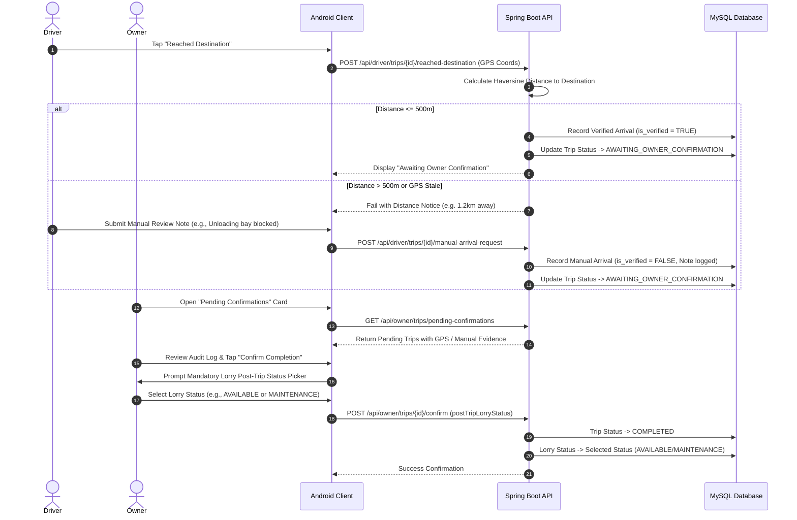

# Owner Operational Workflows

**Document ID:** LFM-DOC-004  
**Version:** 1.0.0 (Stage 1 Design)  
**Status:** DRAFT - PENDING OWNER REVIEW  
**Last Updated:** 2026-10-24  

---

## 1. Overview

The Fleet Owner manages all commercial, administrative, and logistical operations through a dedicated mobile dashboard. This document defines the step-by-step user journeys and operational workflows executed by the Owner.

```mermaid
flowchart TD
    A[Login with Owner Credentials] --> B[Owner Dashboard Overview]
    
    B --> C[1. Fleet & Vehicle Onboarding]
    B --> D[2. Driver Account Management]
    B --> E[3. Trip Planning & Dispatch]
    B --> F[4. Active Trip & GPS Monitoring]
    B --> G[5. Completion Review & Lorry Turnaround]
    B --> H[6. Financial Bookkeeping & Expenses]
    B --> I[7. Monthly P&L Reports & PDF Sharing]

    E -->|Checks Lorry Status = AVAILABLE| E1[Assign Lorry & Driver(s)]
    E1 -->|Sets Trip Code, Route & Amount| E2[Trip Status: ASSIGNED]

    G -->|Driver Requests Arrival| G1{GPS Check <= 500m?}
    G1 -->|Yes: Verified| G2[Inspect GPS Audit Log]
    G1 -->|No: Manual Fallback| G3[Review Driver Explanation]
    G2 --> G4[Owner Confirms Completion]
    G3 --> G4
    G4 --> G5[Mandatory Gating: Set Lorry to AVAILABLE / MAINTENANCE / UNAVAILABLE]
```

---

## 2. Core Operational Workflows

### Workflow 1: Initial Login & Session Management
1. **Launch App:** Owner launches the private Android application.
2. **Authentication:** Inputs authorized Owner username and password.
3. **Session Issuance:** The backend authenticates credentials via BCrypt and returns a signed JWT bearer token with claims `role: ROLE_OWNER`.
4. **Dashboard Redirection:** The app securely persists the token in Android `EncryptedSharedPreferences` and opens the Owner Dashboard.
5. **Session Expiry / Renewal:** If token expires or is revoked, the app intercepts the HTTP 401 response and smoothly redirects to the login screen with a user-friendly notice.

---

### Workflow 2: Lorry Onboarding & Status Lifecycle Management
1. **Navigate to Lorries:** Owner taps **Lorries** navigation tab or **Add Lorry** action button.
2. **Enter Vehicle Specifications:**
   - Registration Number (mandatory, uppercase formatted, e.g., `AP 26 XX 1234`).
   - Vehicle Model & Year (e.g., *Ashok Leyland 2820 HG*, 2023).
   - Payload Capacity (e.g., 20 Metric Tons).
   - Telematics Device Identifier (Ashok Leyland iALERT unit ID or GPS IMEI).
   - Initial Operational Status (defaults to `AVAILABLE`).
3. **Validation & Save:** System verifies registration number uniqueness. Lorry profile is saved in `lorries` table.
4. **Subsequent Status Adjustments:** Owner can manually transition a lorry to `MAINTENANCE` (for planned workshop overhaul) or `UNAVAILABLE` (document renewal, insurance inspection) at any time.

---

### Workflow 3: Driver Account Provisioning & Governance
1. **Navigate to Drivers:** Owner taps **Drivers** section.
2. **Create Permanent Account:**
   - Owner taps **Add Driver**.
   - Fills in: Full Name (e.g., *Ramesh Kumar*), Mobile Number (e.g., `+91 9876543210`), Commercial Driving License Number (e.g., `AP26 20180004521`), Permanent Username (e.g., `driver_ramesh`), and Temporary Password.
3. **Account Commitment:** Account is created with `status = ACTIVE` and role `ROLE_DRIVER`.
4. **Permanent Nature:** Owner is notified that this account is permanent and will remain linked to the driver's historical trip performance indefinitely.
5. **Governance Actions:**
   - **Password Reset:** If a driver forgets their password, the Owner can generate a temporary reset password.
   - **Deactivation:** If a driver takes extended leave or ceases employment, the Owner toggles account status to `INACTIVE`.

---

### Workflow 4: Trip Creation, Validation & Dispatch
1. **Trigger Creation:** Owner taps **Add Trip** on Dashboard or Trips screen.
2. **Lorry Selection with Eligibility Enforcement:**
   - System displays a dropdown of lorries.
   - **Strict Rule:** Lorries marked `ON_TRIP`, `MAINTENANCE`, or `UNAVAILABLE` are disabled with explanatory badges.
   - Owner selects an `AVAILABLE` lorry.
3. **Route & Location Specification:**
   - Starting Location: Input city/hub name (e.g., *Nellore Depot*).
   - Destination Location: Input target city/warehouse name (e.g., *Hyderabad Industrial Area*).
   - Target Coordinates: Input or pin destination Latitude & Longitude (used by the 500m GPS arrival engine).
4. **Commercial Pricing (Confidential):**
   - Freight Trip Amount: Input agreed freight charges in INR (e.g., `₹28,500`).
   - *This value is stored securely and never exposed to driver-facing endpoints.*
5. **Driver Assignment:**
   - Primary Driver: Select from list of active drivers (system alerts if driver is currently on an active trip).
   - Co-Driver / Relief Driver: Optionally select an additional driver.
6. **Dispatch Confirmation:**
   - Owner reviews trip summary and taps **Create & Dispatch Trip**.
   - Trip record is created with status `ASSIGNED`.
   - Lorry operational status updates to `ON_TRIP`.

---

### Workflow 5: Destination Arrival Review & Completion Confirmation Gate
This workflow enforces the crucial business gate preventing premature or fraudulent trip closures:



1. **Notification / Alert:** The Owner Dashboard highlights a pending confirmation badge.
2. **Review Evidence:**
   - If verified by GPS: Owner sees exact arrival timestamp, coordinates, and distance from destination (e.g., *120 metres away*).
   - If submitted via manual fallback: Owner sees driver's explanation note (e.g., *Factory security gate delayed entry; parked at designated outer bay*).
3. **Completion Approval & Mandatory Lorry Turnaround Gate:**
   - Owner taps **Confirm Trip Completion**.
   - A mandatory modal appears: **"Set Post-Trip Lorry Status"**.
   - Options:
     * `AVAILABLE` — Lorry is inspected and ready for immediate dispatch.
     * `MAINTENANCE` — Lorry requires routine servicing, oil change, tyre work, or mechanical repairs before next trip.
     * `UNAVAILABLE` — Lorry is docked for paperwork, driver rest, or administrative reasons.
   - Upon confirmation, trip transitions to `COMPLETED` and lorry status is updated accordingly.

---

### Workflow 6: Financial Bookkeeping (Income, Expenses, Maintenance)
1. **Logging Trip Freight Income:**
   - Owner opens completed or ongoing trip, or navigates to **Income**.
   - Records income received: Payment Date, Amount (₹), Payment Mode (Bank Transfer, Cheque, Cash), Payer Party, and Reference Notes.
2. **Logging Operating Expenses:**
   - Owner taps **Add Expense**.
   - Selects Lorry: e.g., `AP 26 XX 1234`.
   - Selects Category: `DIESEL`, `TOLL`, `REPAIRS`, `TYRES`, `SERVICING`, or `OTHER`.
   - Enters Date, Amount (₹), and Description (e.g., *HPCL Diesel 180 Litres @ ₹92.40* or *Tyre retreading - rear axle*).
   - Saves record.
3. **Logging Workshop Maintenance:**
   - Owner logs major maintenance overhaul: Service Date, Workshop Name, Total Invoice Cost, Odometer reading, and Next Service Due Milestone (date or km).

---

### Workflow 7: Monthly P&L Reporting & PDF Sharing
1. **Access Reports Screen:** Owner taps **Monthly Reports**.
2. **Filter Selection:** Selects Target Month and Year (e.g., *October 2026*).
3. **Summary Inspection:**
   - Total Monthly Revenue (₹)
   - Total Operating Expenses (₹)
   - Net Profit or Loss (₹)
   - Lorry-wise breakdown table (Freight Earned vs Direct Diesel/Maintenance Spent per vehicle)
   - Expense Category donut/bar breakdown (Diesel %, Tolls %, Repairs %, Other %)
4. **Generate & Share PDF:**
   - Owner taps **Generate PDF Report**.
   - System renders a formatted PDF document.
   - App triggers native Android Share Sheet (`Intent.ACTION_SEND`), allowing direct sharing to WhatsApp, Email, or printing via Android Print Spooler.
