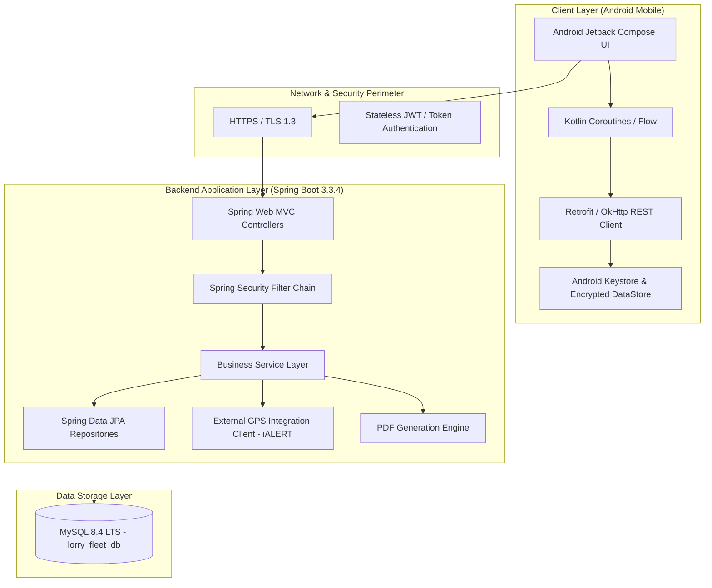

# Project Overview: Lorry Fleet Manager

**Document ID:** LFM-DOC-001  
**Version:** 1.0.0 (Stage 1 Design)  
**Status:** DRAFT - PENDING OWNER REVIEW  
**Last Updated:** 2026-10-24  

---

## 1. Executive Summary

**Lorry Fleet Manager** is a private, enterprise-tailored mobile and backend system designed specifically for a lorry fleet operator managing a small fleet of commercial freight vehicles (initially approximately 5 lorries and up to 15 users, consisting of 1 fleet owner and multiple drivers).

The system replaces manual logbooks, phone calls, and fragmented messaging by centralizing:
1. Fleet vehicle lifecycle and availability management.
2. Permanent driver account management.
3. Trip dispatch, multi-driver assignments, and milestone tracking.
4. GPS destination verification with an initial 500-metre geofence tolerance.
5. Strict owner-controlled completion gates and lorry turnaround status checks.
6. Owner-confidential financial bookkeeping (trip freight income, fuel/diesel expenses, tolls, maintenance, tyres, repairs).
7. Monthly profit and loss reporting with exportable, shareable PDF summaries.

Distribution is planned strictly as a private Android Application Package (APK) directly installed on company devices or drivers' personal Android smartphones. Public Google Play Store distribution is explicitly out of scope for the initial deployment.

---

## 2. Business Objectives & Operational Context

| Dimension | Description |
| :--- | :--- |
| **Fleet Scale** | Approximately 5 heavy commercial vehicles (e.g., Ashok Leyland haulage/tipper lorries). |
| **User Population** | Up to 15 total users (1 Fleet Owner / Administrative Account, ~10-14 Registered Drivers). |
| **Operational Geography** | Regional and inter-state logistics (e.g., Nellore to Hyderabad, Chennai, Bengaluru, etc.). |
| **Distribution Model** | Private Android APK side-loaded or distributed via secure company link. No Google Play Store publication. |
| **Hosting Strategy** | Free-tier cloud hosting during pilot/validation phase; transition to dedicated paid VPS/cloud when justified by load or uptime requirements. |
| **Primary Value Drivers** | Real-time trip status clarity, fraud prevention at trip arrival, strict isolation of business financials from drivers, clear monthly profit calculations, and vehicle health visibility. |

---

## 3. Technology Stack Baseline

The project builds upon an already established repository structure, preserving existing working configurations and dependencies:

### Component Breakdown
* **Android Application (`/android-app`)**:
  - Language: Kotlin 2.2.10
  - UI Toolkit: Jetpack Compose (BOM `2026.02.01`) with Material 3 styling
  - Target SDK: 37 | Minimum SDK: 26 (Android 8.0 Oreo, covering 95%+ of active Android devices)
  - Build System: Gradle 9.6.0 with Kotlin DSL
* **Backend Foundation (`/backend`)**:
  - Language & Runtime: Java 21 LTS
  - Framework: Spring Boot 3.3.4
  - Security: Spring Security 6 with stateless token handling, BCrypt password hashing, and role-based endpoint isolation
  - Persistence: Spring Data JPA / Hibernate ORM with strict schema validation (`ddl-auto: validate`)
  - Build Tool: Apache Maven 3.9+ with `mvnw` wrapper
* **Database (`lorry_fleet_db`)**:
  - Engine: MySQL 8.4 LTS / MySQL 8.0+
  - Character Set: `utf8mb4` | Collation: `utf8mb4_unicode_ci`

---

## 4. Confirmed Requirements vs. Working Assumptions

To ensure requirements integrity, all specifications are categorized into confirmed facts and provisional assumptions requiring owner validation.

### Confirmed Requirements
1. **Fleet Size**: Sized for ~5 lorries and a maximum of 15 users initially.
2. **Roles**: Distinct roles for OWNER and DRIVER.
3. **No Public Owner Registration**: The initial owner account is provisioned via an authorized administrative bootstrap; self-registration by the public is strictly prohibited.
4. **Permanent Driver Accounts**: Drivers have permanent credentials managed by the owner; accounts are **never** deleted upon trip completion.
5. **Strict Financial Privacy**: Drivers must **never** see freight rates, trip amounts, operating income, operating expenses, profit/loss calculations, or owner financial reports. This privacy rule must be enforced by the backend REST layer, not merely hidden in the mobile UI.
6. **Multi-Driver Trips**: A trip can have one or multiple assigned drivers (e.g., primary driver and relief/co-driver).
7. **Lorry Turnaround Control**: A completed trip does **not** automatically make the lorry available. The owner must explicitly set the lorry availability status to `AVAILABLE`, `MAINTENANCE`, or `UNAVAILABLE`.
8. **Trip Completion Verification**: Drivers trigger a "Reached Destination" request; the system verifies location against a 500-metre destination geofence; owner reviews and grants final completion approval.
9. **Private APK**: No Google Play Store requirement.

### Working Assumptions (Pending Final Owner Sign-off)
1. **Destination Geofence Coordinates**: Assumes trip destinations can be stored with latitude and longitude (either selected via map pin or geocoded from landmark/city names) to enable the 500-metre radius check.
2. **iALERT API Access**: The owner utilizes Ashok Leyland's iALERT telematics. It is assumed the owner will obtain commercial API credentials from Ashok Leyland. A mobile-phone GPS fallback architecture is planned if API access is delayed or cost-prohibitive.
3. **Driver Assignment Exclusivity**: A lorry cannot be on two active trips concurrently. A driver cannot be primary driver on two concurrent in-progress trips.
4. **Push Notifications**: Assumes Firebase Cloud Messaging (FCM) can be configured for out-of-app push notifications, with an in-app dashboard polling fallback.

---

## 5. Scope Boundary Matrix

| In Scope (Stages 1 - 5) | Out of Scope (Explicitly Excluded) |
| :--- | :--- |
| Owner & Driver Authentication (JWT) | Public user self-registration |
| Lorry CRUD and operational state management | Google Play Store publishing & billing |
| Permanent Driver account provisioning by Owner | Public customer booking portal |
| Trip dispatch with single/multiple drivers | Third-party shipper freight tracking portals |
| 500m GPS arrival check & manual review fallback | Automated payment gateway integrations (Razorpay/UPI) |
| Owner completion confirmation gate | In-app automated payroll or driver salary calculations |
| Lorry post-trip status assignment | Multi-tenant SaaS architecture (single fleet focus) |
| Lorry-wise expense, income, and maintenance tracking | Hardware telematics OBD-II firmware flashing |
| Monthly profit/loss summaries and PDF sharing | Real-time sub-second continuous video dashcam streaming |

---

## 6. Budget & Hosting Strategy

### Phase 1: Free-Tier Evaluation
During initial user acceptance testing (UAT) and early fleet trials, the backend and database will be evaluated on free-tier cloud platforms:
- **Application Backend**: Free container runtime (e.g., Render, Railway free trial, Koyeb, or Oracle Cloud Always Free VM).
- **Database**: Free managed MySQL instance (e.g., Aiven free tier, TiDB Serverless, Oracle Always Free MySQL, or local port forwarding during early testing).

#### Known Constraints of Free Hosting:
1. **Cold Starts**: Services like Render spin down inactive instances after 15 minutes of inactivity; initial API requests may take 30–50 seconds to respond.
2. **Storage and RAM Caps**: Free instances typically provide 512 MB RAM, requiring tight JVM memory tuning (`-Xmx384m -Xms128m`).
3. **Uptime SLA**: Free plans offer zero availability guarantees.

### Phase 2: Production Hosting Roadmap
When the owner validates the pilot and requires 24/7 reliability for drivers on the road, migrate to a cost-effective virtual private server (VPS):
- **Provider Candidates**: Hetzner Cloud (approx. €4–6/month), DigitalOcean Droplet ($6/month), or AWS Lightsail ($5/month).
- **Setup**: Docker Compose running Spring Boot container + MySQL 8.4 container with automated local backup scripts.

---

## 7. Master Document Index & Stage 1 Deliverables

The complete architectural plan for Stage 1 consists of the following modular documents located in the `/docs` directory:

1. [`project-overview.md`](project-overview.md) — Master context, technology stack, scope boundary, and hosting plan.
2. [`requirements.md`](requirements.md) — Detailed functional, non-functional, and domain requirements.
3. [`user-roles-and-permissions.md`](user-roles-and-permissions.md) — Comprehensive RBAC specifications for Owner and Driver roles.
4. [`owner-workflow.md`](owner-workflow.md) — Step-by-step owner operational workflows from vehicle onboarding to report export.
5. [`driver-workflow.md`](driver-workflow.md) — Driver day-to-day workflow from login to destination arrival request.
6. [`trip-lifecycle.md`](trip-lifecycle.md) — Formal trip finite-state machine (FSM), 500m GPS verification, and completion gates.
7. [`screen-inventory.md`](screen-inventory.md) — Complete Android Jetpack Compose screen catalog, UI wireframes, and UX guidelines.
8. [`database-design.md`](database-design.md) — Relational schema, tables, foreign keys, indexes, and conservative migration strategy.
9. [`api-plan.md`](api-plan.md) — Comprehensive REST API catalog, endpoints, DTO contracts, security filters, and HTTP status mappings.
10. [`gps-integration-plan.md`](gps-integration-plan.md) — Ashok Leyland iALERT technical discovery, telemetry mapping, and driver-phone GPS fallback.
11. [`security-requirements.md`](security-requirements.md) — Authentication architecture, data privacy, secret handling, and Android hardening.
12. [`stage-status.md`](stage-status.md) — Master Stage 1 completion tracker and Stage 2 readiness review.
13. [`../MASTER_PROGRESS.md`](../MASTER_PROGRESS.md) — Root-level progress tracker and executive summary.
