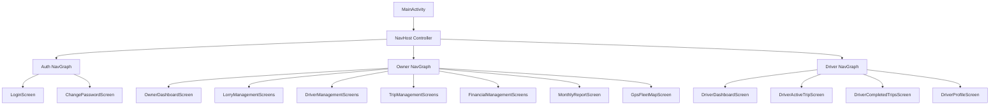

# Screen Inventory & UI Design Specification

**Document ID:** LFM-DOC-007  
**Version:** 1.0.0 (Stage 1 Design)  
**Status:** DRAFT - PENDING OWNER REVIEW  
**Last Updated:** 2026-10-24  

---

## 1. UI Architecture & Design System

The mobile application is built using **Android Jetpack Compose** following a single-activity architecture (`MainActivity.kt`) managed by the Jetpack Navigation Component.



### Design Standards:
* **Toolkit:** Jetpack Compose with Material Design 3 (`androidx.compose.material3`).
* **Color Palette:**
  - *Primary Fleet Blue:* `#1565C0` (Navigation bars, primary action buttons)
  - *Secondary / Accent Amber:* `#FFA000` (Pending actions, warnings)
  - *Success Green:* `#2E7D32` (Available lorries, verified arrival, profit)
  - *Error / Alert Red:* `#C62828` (Maintenance lorries, verification failure, loss)
  - *Neutral Surface:* `#F8F9FA` (High-contrast light background for direct sunlight readability)
* **Touch Targets & Typography:**
  - Minimum touch target: $48 \times 48\text{ dp}$ across all interactive buttons.
  - Body typography: 16sp regular with 24sp headlines, optimized for drivers reading in vibrating vehicle cabs.

---

## 2. Complete Screen Catalog

### 2.1 Common & Authentication Screens

| Screen ID | Screen Name | Route | Description & Key UI Elements |
| :--- | :--- | :--- | :--- |
| **SCR-AUTH-01** | Login Screen | `auth/login` | Username and password input fields, password toggle, "Sign In" button, branded lorry fleet logo. Clean error banner for invalid credentials or deactivated accounts. |
| **SCR-AUTH-02** | Change Password Screen | `user/change-password` | Current password, new password, confirm new password fields, validation strength indicator, "Update Password" button. |
| **SCR-AUTH-03** | User Profile Screen | `user/profile` | Display user full name, permanent username, role badge (`OWNER` or `DRIVER`), phone number, driving license number, "Change Password" link, and "Sign Out" button. |

---

### 2.2 Owner Screens (Administrative Console)

| Screen ID | Screen Name | Route | Description & Key UI Elements |
| :--- | :--- | :--- | :--- |
| **SCR-OWN-01** | Owner Dashboard Screen | `owner/dashboard` | Executive overview: 6 KPI Cards (Total Lorries, Lorries on Trip, Available Lorries, Lorries in Maintenance, Active Trips, Pending Trip Confirmations). Quick action floating buttons for "Add Trip" and "Add Expense". Bottom navigation bar (Dashboard, Lorries, Drivers, Trips, Reports). |
| **SCR-OWN-02** | Lorry List Screen | `owner/lorries` | Card-based list of the 5 fleet lorries. Each card displays Registration Number, Make/Model, Carrying Capacity, and Operational Status chip (`AVAILABLE`, `ON_TRIP`, `MAINTENANCE`, `UNAVAILABLE`). Floating button: "Add Lorry". |
| **SCR-OWN-03** | Add / Edit Lorry Screen | `owner/lorries/form` | Form fields: Registration Number (uppercase), Model, Carrying Capacity (Tons), iALERT Telematics Unit ID / GPS IMEI, Notes. Dropdown for manual status override. |
| **SCR-OWN-04** | Driver List Screen | `owner/drivers` | List of permanent driver accounts. Displays Driver Name, Phone Number, Assigned Trip (if active), and Status toggle (`ACTIVE` / `INACTIVE`). Action button: "Add Driver". |
| **SCR-OWN-05** | Add / Edit Driver Screen | `owner/drivers/form` | Form fields: Full Name, Permanent Username, Initial Temporary Password, Mobile Phone Number, Driving License Number, Address notes. |
| **SCR-OWN-06** | Trip List Screen | `owner/trips` | Paginated trip list with tab filters: `ALL`, `ACTIVE`, `PENDING_CONFIRMATION`, `COMPLETED`, `CANCELLED`. Search bar for Trip Code or Lorry number. |
| **SCR-OWN-07** | Create Trip Screen | `owner/trips/create` | Multi-step trip dispatch form: Lorry dropdown (*strictly filtered to `AVAILABLE` lorries only*), Origin city, Destination city, Destination Lat/Lng coordinates (or map pin), Trip Freight Amount (₹, confidential), Primary Driver selector, Optional Co-driver selector, Departure Date, Cargo notes. Button: "Dispatch Trip". |
| **SCR-OWN-08** | Owner Trip Detail Screen | `owner/trips/{id}` | Detailed trip overview: Route timeline, driver assignments, vehicle status, Owner-confidential freight revenue (₹), linked fuel/toll expenses, net trip margin. Section for "Arrival Verification Evidence" (GPS audit or manual note). Action buttons: "Confirm Trip Completion" and "Cancel Trip". |
| **SCR-OWN-09** | Completion Review & Turnaround Dialog | Overlay Modal | Triggered upon tapping "Confirm Trip Completion". Displays: Verified GPS distance / manual reason note. Mandatory dropdown: **Post-Trip Lorry Status** (`AVAILABLE`, `MAINTENANCE`, `UNAVAILABLE`). Action buttons: "Approve Completion" and "Reject / Demand Re-Check". |
| **SCR-OWN-10** | GPS Fleet Map Screen | `owner/tracking` | Map view rendering last known coordinates of all 5 lorries, or toggleable list view showing last ping timestamp, vehicle speed, ignition status (from iALERT API or driver phone). |
| **SCR-OWN-11** | Financial Overview Screen | `owner/finance` | Financial dashboard: Tabs for `INCOME`, `EXPENSES`, and `MAINTENANCE`. Monthly total cards. Action buttons: "Add Income", "Add Expense", "Log Maintenance". |
| **SCR-OWN-12** | Add Income Screen | `owner/finance/income/add`| Form fields: Lorry selection, Trip linking (optional), Amount (₹), Received Date, Payer Name / Consignor, Payment Mode (Bank, Cash, Cheque), Notes. |
| **SCR-OWN-13** | Add Expense Screen | `owner/finance/expenses/add`| Form fields: Lorry selection, Trip linking (optional), Expense Category dropdown (`DIESEL`, `TOLL`, `REPAIRS`, `TYRES`, `SERVICING`, `OTHER`), Amount (₹), Date, Fuel Litres (if Diesel), Vendor / Fuel Station name, Description. |
| **SCR-OWN-14** | Maintenance Log Screen | `owner/finance/maintenance`| List and form for workshop servicing: Lorry, Service Category (Routine Servicing, Oil Change, Tyre Replacement, Major Overhaul), Invoice Cost (₹), Service Date, Odometer (km), Next Service Due Date/Km. |
| **SCR-OWN-15** | Monthly Financial Report & PDF Export | `owner/reports` | Month/Year selector. Rendered metrics: Total Revenue (₹), Total Operating Expenses (₹), Net Profit / Loss (₹). Per-vehicle breakdown table. Expense category breakdown bar. Button: "Generate & Share PDF" (opens Android Share Sheet for WhatsApp/Email sharing). |

---

### 2.3 Driver Screens (Mobile Field Console)

| Screen ID | Screen Name | Route | Description & Key UI Elements |
| :--- | :--- | :--- | :--- |
| **SCR-DRV-01** | Driver Dashboard Screen | `driver/dashboard` | Clean, high-contrast dashboard: Greeting banner with driver name and active vehicle. Hero Card: **Active Trip** (if assigned) with prominent origin, destination, and status badge. List of **Upcoming Assigned Trips**. Button to view **Completed Trips History**. |
| **SCR-DRV-02** | Driver Active Trip Detail Screen | `driver/trips/{id}` | Full active trip screen: Trip Code, Lorry Registration Number, Origin, Destination, Scheduled Departure. Prominent button: **"Open in Google Maps"** (opens turn-by-turn navigation). Large, full-width action button: **"Reached Destination"**. *Zero financial figures displayed.* |
| **SCR-DRV-03** | Arrival Verification Modal | Overlay Modal | Interactive modal triggered by "Reached Destination":<br>• *State A (Verifying):* Circular progress indicator with text "Verifying GPS location...".<br>• *State B (Success $\le 500$m):* Green checkmark, text "Destination Verified! Request submitted to Fleet Owner." Status updates to `Awaiting Owner Confirmation`.<br>• *State C (Failure $> 500$m):* Amber warning, text "You are 1.4 km from destination." Buttons: "Retry GPS Check" and "Submit for Manual Review". |
| **SCR-DRV-04** | Manual Arrival Submission Screen | Overlay Dialog | Text input: "Explain reason for manual arrival submission (e.g. Security held lorry at outer gate)". Character limit: 250 chars. Button: "Submit to Owner". |
| **SCR-DRV-05** | Driver Completed Trips Screen | `driver/history` | Paginated list of past completed trips performed by this driver. Cards display: Trip Code, Dates, Lorry Reg Number, Origin $\rightarrow$ Destination. Read-only historical log. |

---

## 3. UI Component Wireframe Sketches

### 3.1 Owner Dashboard Wireframe (Conceptual)
```
+---------------------------------------------------+
|  LORRY FLEET MANAGER                 [User Icon]  |
+---------------------------------------------------+
|  FLEET STATUS OVERVIEW                            |
|  +---------------------+   +---------------------+|
|  | TOTAL LORRIES:  5   |   | ACTIVE TRIPS:   2   |  |
|  +---------------------+   +---------------------+|
|  | AVAILABLE:      2   |   | MAINTENANCE:    1   |  |
|  +---------------------+   +---------------------+|
|                                                   |
|  PENDING CONFIRMATIONS (1) [!]                    |
|  +-----------------------------------------------+|
|  | AP 26 XX 1234 - Hyderabad Unloading Bay        |
|  | Driver: Ramesh Kumar | GPS Verified (120m away)|
|  | [ Review & Confirm Completion ]                |
|  +-----------------------------------------------+|
|                                                   |
|  RECENT TRIPS                                     |
|  * TRP-0021 | AP 26 YY 5678 | Nellore -> Chennai  |
|    Status: IN PROGRESS                            |
|                                                   |
|  [+] Add Trip           [$] Add Expense           |
+---------------------------------------------------+
|  [Dashboard]  [Lorries]  [Drivers]  [Trips] [P&L] |
+---------------------------------------------------+
```

### 3.2 Driver Dashboard Wireframe (Conceptual)
```
+---------------------------------------------------+
|  DRIVER CONSOLE                      [User Icon]  |
|  Hello, Ramesh Kumar (Driver01)                   |
+---------------------------------------------------+
|  CURRENT ACTIVE TRIP                              |
|  +-----------------------------------------------+|
|  | LORRY: AP 26 XX 1234 (Ashok Leyland 2820)     |
|  | FROM:  Nellore Depot                          |
|  | TO:    Hyderabad Sanathnagar Yard              |
|  | DEPARTED: 24 Oct 2026, 06:30 AM                |
|  | STATUS:   IN PROGRESS                          |
|  |                                               |
|  | [-> Launch Google Maps Navigation]            |
|  |                                               |
|  | +-------------------------------------------+ |
|  | |       [ REACHED DESTINATION ]             | |
|  | +-------------------------------------------+ |
|  +-----------------------------------------------+|
|                                                   |
|  UPCOMING TRIPS (1)                               |
|  * 28 Oct 2026: Nellore -> Bangalore             |
|                                                   |
|  [ View Completed Trip History ]                  |
+---------------------------------------------------+
```
