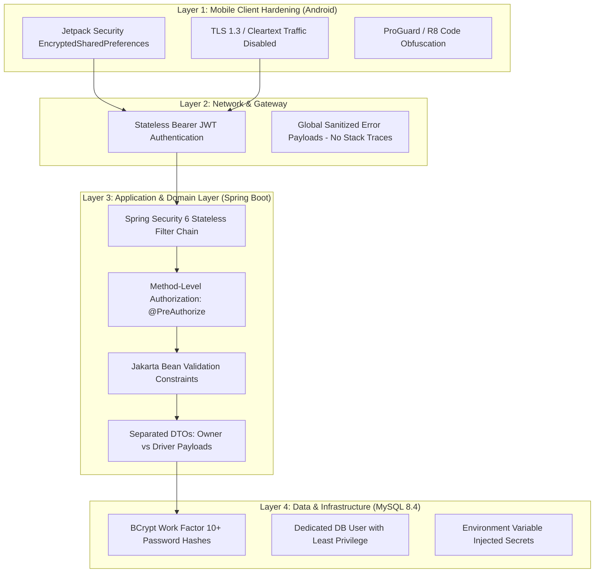

# Security Architecture & Data Privacy Requirements

**Document ID:** LFM-DOC-011  
**Version:** 1.0.0 (Stage 1 Design)  
**Status:** DRAFT - PENDING OWNER REVIEW  
**Last Updated:** 2026-10-24  

---

## 1. Security Architecture Principles

The Lorry Fleet Manager system processes sensitive business assets: commercial freight revenue, operational costs, vehicle telemetry, and employee credentials. Security is designed with defense-in-depth across the mobile client, network perimeter, application service layer, and database storage.



---

## 2. Authentication Architecture (JWT & BCrypt)

### 2.1 Token Lifecycle & Structure
* **Protocol:** JSON Web Token (JWT) signed with HMAC-SHA256 (`HS256`) or RSA-256 using a minimum 256-bit secret injected via the `JWT_SECRET` environment variable.
* **Claims Structure:**
  - `sub`: Permanent username (e.g., `driver_ramesh` or `owner_admin`).
  - `userId`: Internal database identifier.
  - `role`: System authority (`ROLE_OWNER` or `ROLE_DRIVER`).
  - `iat`: Issued-at UTC timestamp.
  - `exp`: Expiration UTC timestamp (default: 7-day mobile access token).
* **Stateless Session Management:** The backend does not maintain in-memory HTTP sessions (`SessionCreationPolicy.STATELESS`), allowing horizontal scaling and eliminating session hijacking risks.

### 2.2 Password Protection Standards
* **Hashing Algorithm:** BCrypt (`BCryptPasswordEncoder` bean configured with work factor 10).
* **Salt Generation:** Secure random salt generated automatically per password hash.
* **Password Policy:** Minimum 8 characters, including at least one uppercase letter, one lowercase letter, and one numerical digit.
* **Zero Logging Invariant:** Plaintext passwords, raw authorization headers, and reset tokens must **never** be logged to console, disk logs, or database columns.

---

## 3. Commercial Data Privacy & Driver Isolation

The fleet owner's business viability requires that commercial freight rates, customer billing terms, and profitability remain completely confidential.

### 3.1 Strict Anti-Leakage Measures:
1. **Endpoint Access Denial:** Drivers attempting to access `/api/owner/**` receive immediate `HTTP 403 Forbidden` responses.
2. **DTO Attribute Segregation:** Classes returned to drivers (e.g. `DriverTripSummaryResponse`) **do not contain** `tripAmount`, `operatingCost`, or `profit` attributes. Financial data is never serialized into driver HTTP responses.
3. **Database Query Scoping:** Driver queries are filtered by:
   ```sql
   WHERE assignment.driver_id = :authenticatedDriverId
   ```
   A driver cannot enumerate, query, or infer trips or personal records assigned to other drivers.

---

## 4. Mobile Client Hardening (Android)

### 4.1 Token Storage via Jetpack Security
Plain Android `SharedPreferences` or unencrypted SQLite databases are vulnerable to extraction on rooted devices.
* The application shall store JWT authentication tokens using **Jetpack Security `EncryptedSharedPreferences`**:
  ```kotlin
  val masterKey = MasterKey.Builder(context)
      .setKeyScheme(MasterKey.KeyScheme.AES256_GCM)
      .build()

  val securePrefs = EncryptedSharedPreferences.create(
      context,
      "secure_fleet_prefs",
      masterKey,
      EncryptedSharedPreferences.PrefKeyEncryptionScheme.AES256_SIV,
      EncryptedSharedPreferences.PrefValueEncryptionScheme.AES256_GCM
  )
  ```

### 4.2 Network Security & Cleartext Traffic Ban
* In `AndroidManifest.xml`, cleartext HTTP traffic is strictly prohibited:
  ```xml
  <application
      android:usesCleartextTraffic="false"
      android:networkSecurityConfig="@xml/network_security_config">
  ```
* All client-server communication must occur over TLS 1.2 or TLS 1.3.

### 4.3 Code Obfuscation & Build Hardening
* In release builds, Android R8/ProGuard shrinks and obfuscates class, field, and method names to prevent reverse-engineering of decompiled APKs.

---

## 5. Secret Management & Environmental Hygiene

1. **Zero Hardcoded Secrets Policy:** No passwords, JDBC connection strings, database usernames, JWT signing secrets, or third-party telematics keys may ever be committed to Git.
2. **Configuration Ingestion:** All secrets are bound via environment variables:
   - `DB_URL` — Full JDBC connection URL.
   - `DB_USERNAME` — Dedicated application user (e.g., `lorry_app_user`, not `root`).
   - `DB_PASSWORD` — Cryptographically random database password.
   - `JWT_SECRET` — 256-bit cryptographically secure string.
   - `IALERT_API_KEY` — Third-party telematics credential.
3. **Git Hygiene:** Root `.gitignore` enforces exclusion of `.env`, `application-local.yml`, and `*.properties`.

---

## 6. Information Leakage & Error Sanitization

1. **Disabled Stack Traces:** Spring Boot default error attributes are suppressed in `application.yml`:
   ```yaml
   server:
     error:
       include-stacktrace: never
       include-message: never
       include-binding-errors: never
   ```
2. **Centralized Exception Handling:** `GlobalExceptionHandler` logs detailed stack traces internally to secure server logs while returning a sanitized JSON envelope to the mobile client:
   ```json
   {
     "timestamp": "2026-10-24T14:15:00Z",
     "status": 500,
     "error": "Internal Server Error",
     "message": "An unexpected internal error occurred. Please contact system support.",
     "path": "/api/owner/trips"
   }
   ```
3. **Database Error Masking:** SQL syntax exceptions, table names, constraint violation messages, and HikariCP connection details are never returned to client devices.

---

## 7. Account Governance & Deactivation Protocol

* **Account Deactivation:** If a driver resigns or is suspected of misconduct, the Owner toggles `is_active = FALSE`:
  1. The user record is immediately flagged inactive in the database.
  2. The JWT authentication filter checks user `is_active` status on protected calls.
  3. All requests from deactivated credentials immediately return `401 Unauthorized` / `403 Forbidden`.
  4. The mobile app detects this response, purges cached local tokens, and forces a redirect to the login screen.
* **Driver Account Permanence:** Completed trips never trigger driver account deletion. Permanent driver accounts preserve historical audit records indefinitely.
