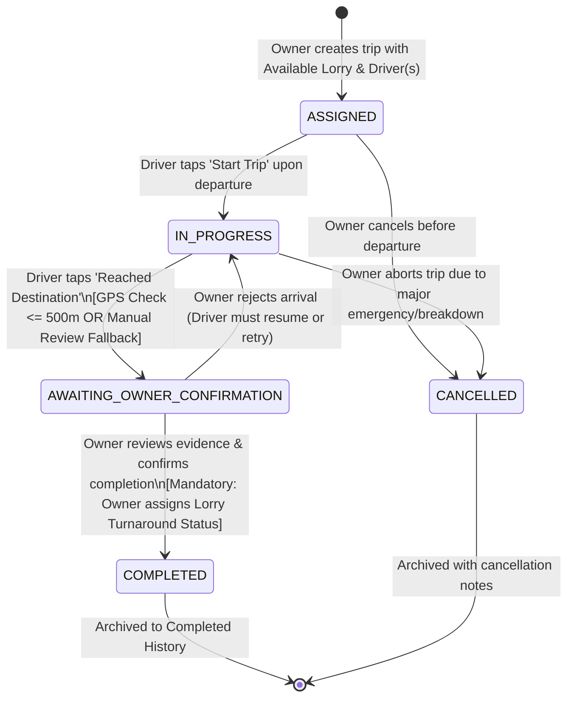

# Trip Lifecycle & Geofence Verification Specification

**Document ID:** LFM-DOC-006  
**Version:** 1.0.0 (Stage 1 Design)  
**Status:** DRAFT - PENDING OWNER REVIEW  
**Last Updated:** 2026-10-24  

---

## 1. State Machine Architecture

The Trip lifecycle is modeled as a deterministic Finite State Machine (FSM). State changes are strictly enforced at the backend entity level. Direct arbitrary status mutations via REST are rejected.

---

## 2. Formal Transition Matrix

| From State | Event / Trigger | Triggering Actor | Pre-Conditions | To State | Side Effects & Invariants |
| :--- | :--- | :--- | :--- | :--- | :--- |
| **None** | `CREATE_TRIP` | Owner | Lorry is `AVAILABLE`; Driver(s) active and not conflicted. | `ASSIGNED` | Lorry operational status switches to `ON_TRIP`. Trip code generated. Audit log entry created. |
| `ASSIGNED` | `START_TRIP` | Assigned Driver or Owner | Scheduled start reached; vehicle departs depot. | `IN_PROGRESS` | `actual_start_time` recorded. Mobile client activates in-transit UI mode. |
| `ASSIGNED` | `CANCEL_TRIP` | Owner | Trip not yet departed; valid cancellation reason entered. | `CANCELLED` | Lorry operational status restored to `AVAILABLE` (or Owner choice). Audit log recorded. |
| `IN_PROGRESS` | `SUBMIT_ARRIVAL_GPS` | Assigned Driver | Current coordinates sampled within 500m of destination. | `AWAITING_OWNER_CONFIRMATION` | `is_gps_verified = TRUE`. Distance, timestamp, and coordinates saved in completion request log. |
| `IN_PROGRESS` | `SUBMIT_ARRIVAL_MANUAL` | Assigned Driver | GPS failed/unavailable; driver inputs mandatory explanation note. | `AWAITING_OWNER_CONFIRMATION` | `is_gps_verified = FALSE`. Manual review required flag set. Note saved in audit log. |
| `AWAITING_OWNER_CONFIRMATION` | `CONFIRM_COMPLETION` | Owner | Owner reviews arrival audit; Owner **must** select post-trip lorry status. | `COMPLETED` | `completed_at` timestamp recorded. Active workflow access expires. Lorry status updated to chosen value (`AVAILABLE`/`MAINTENANCE`/`UNAVAILABLE`). |
| `AWAITING_OWNER_CONFIRMATION` | `REJECT_ARRIVAL` | Owner | Owner detects location mismatch or false submission; enters reason. | `IN_PROGRESS` | Trip reverted to `IN_PROGRESS`. Driver alerted to reposition vehicle and re-verify. |
| `IN_PROGRESS` | `ABORT_TRIP` | Owner | Major accident, breakdown, or commercial dispute on highway. | `CANCELLED` | Lorry marked `MAINTENANCE` or `UNAVAILABLE`. Notes recorded. |

---

## 3. Decoupling: Lorry Operational State vs. Trip Lifecycle State

A critical requirement of this architecture is the **strict separation** between a Lorry's operational status and a Trip's lifecycle status:

| Domain | Entity | Status Enumeration | Meaning |
| :--- | :--- | :--- | :--- |
| **Asset State** | `Lorry` | `AVAILABLE` | Vehicle is mechanically sound, clean, fueled, and ready for dispatch. |
| | | `ON_TRIP` | Vehicle is currently committed to an active dispatch (`ASSIGNED` or `IN_PROGRESS`). |
| | | `MAINTENANCE` | Vehicle is docked at a workshop for servicing, oil change, tyre work, or repairs. |
| | | `UNAVAILABLE` | Vehicle is temporarily sidelined (driver rest, RTO permit renewal, insurance, tax). |
| **Process State** | `Trip` | `ASSIGNED`, `IN_PROGRESS`, `AWAITING_OWNER_CONFIRMATION`, `COMPLETED`, `CANCELLED` | Progression of a freight contract from dispatch to delivery confirmation. |

### Why Automatic Availability Upon Trip Completion is Forbidden
Commercial lorries undergo heavy mechanical stress during inter-state haulage. When a trip completes:
- Tyres, engine oil levels, air brake lines, and coolant must be physically inspected.
- The vehicle may need thorough washing or loading-bay turnaround time.
- The owner may have already scheduled preventive maintenance at an authorized service centre.

Therefore, the system **strictly prohibits** automatic transition from `ON_TRIP` to `AVAILABLE`. When the Owner confirms completion, the system presents a mandatory gating dialog requiring the Owner to select the lorry's next operational status:
1. `AVAILABLE` (Ready for immediate re-assignment)
2. `MAINTENANCE` (Sent to workshop)
3. `UNAVAILABLE` (Docked / Resting)

---

## 4. Destination Geofence Verification Subsystem (500-Metre Engine)

### 4.1 Geodetic Calculation (Haversine Formula)
Given the target destination coordinates $(\phi_1, \lambda_1)$ and the driver's current device coordinates $(\phi_2, \lambda_2)$ in radians:
$$\Delta \phi = \phi_2 - \phi_1, \quad \Delta \lambda = \lambda_2 - \lambda_1$$
$$a = \sin^2\left(\frac{\Delta \phi}{2}\right) + \cos(\phi_1)\cos(\phi_2)\sin^2\left(\frac{\Delta \lambda}{2}\right)$$
$$c = 2 \cdot \text{atan2}\left(\sqrt{a}, \sqrt{1-a}\right)$$
$$d = R \cdot c \quad \text{where } R = 6,371,000 \text{ metres}$$

### 4.2 Quality Assurance & Telemetry Filters
To prevent false-positive arrival submissions and GPS spoofing, readings must satisfy:
1. **Freshness Filter:** Reading timestamp must be within $\le 180\text{ seconds}$ ($3\text{ minutes}$) of the submission time. Cached or stale locations from earlier stops are rejected.
2. **Accuracy Radius Filter:** Device horizontal accuracy estimate must be $\le 100\text{ metres}$. If accuracy $> 100\text{m}$ (e.g. cellular tower triangulation during heavy cloud cover), the client instructs the driver to wait for a GPS satellite fix.
3. **Threshold Boundary:**
   - If $d \le 500.0\text{ metres}$: Pass $\rightarrow$ Flagged `GPS_VERIFIED`.
   - If $d > 500.0\text{ metres}$: Fail $\rightarrow$ Explanatory prompt with calculated distance (e.g., *"Current position is 1,350 metres from destination"*).

### 4.3 Reality Caveat: What GPS Proves vs. What It Does Not Prove
> [!IMPORTANT]
> A successful 500-metre GPS verification proves only that **the driver's mobile device was geographically proximate to the target destination coordinates at the time of submission**.
>
> It **does not** prove:
> 1. That freight was safely unloaded.
> 2. That goods were accepted without physical damage or shortages.
> 3. That the consignee signed the physical delivery challan or e-Way Bill.
> 4. That the vehicle has left the unloading premises.
>
> For these reasons, the 500m GPS check serves as an **automated verification filter**, but final trip completion remains strictly contingent upon the **Owner's explicit confirmation gate**.

---

## 5. Manual Review Fallback Architecture

If automated GPS verification cannot be completed due to legitimate field conditions:
1. Consignee factory located in a remote cellular blackspot or deep steel-roofed warehouse where GPS satellite signals attenuate.
2. Driver phone GPS hardware failure or battery degradation.
3. Consignee security guards ordering the lorry to park at an external holding yard outside the 500m perimeter.

### Fallback Procedure:
1. Driver receives the distance warning or GPS error dialog.
2. Driver taps **"Submit for Manual Review"**.
3. App presents a mandatory text field: *"Explain why GPS verification could not be completed"*.
4. Driver submits note (e.g., *"Parked at Outer Container Yard due to warehouse congestion; gate pass #4829 received"*).
5. The request enters `AWAITING_OWNER_CONFIRMATION` tagged with:
   - `is_gps_verified = FALSE`
   - `manual_review_required = TRUE`
   - `driver_submission_notes = "<explanation>"`
6. The Owner Dashboard displays an amber warning badge alert: **"Manual Review Required"**, ensuring the owner contacts the driver or consignee before granting completion.

---

## 6. Audit Trail & State History (`trip_status_history`)

Every state transition generates an immutable record in `trip_status_history` capturing:
* `trip_id`: Reference to the trip.
* `from_status`: Originating state.
* `to_status`: Destination state.
* `changed_by_user_id`: User who triggered the action.
* `trigger_event`: Event name (`START_TRIP`, `SUBMIT_ARRIVAL`, `CONFIRM_COMPLETION`, etc.).
* `latitude`, `longitude`, `accuracy`: Captured coordinates if applicable.
* `notes`: Operational remarks or driver manual explanation.
* `created_at`: Exact UTC timestamp.
