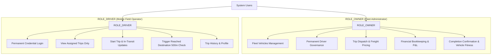

# User Roles and Permissions Specification

**Document ID:** LFM-DOC-003  
**Version:** 1.0.0 (Stage 1 Design)  
**Status:** DRAFT - PENDING OWNER REVIEW  
**Last Updated:** 2026-10-24  

---

## 1. Role Definitions

The system enforces strict Role-Based Access Control (RBAC) with exactly two principal roles:



### 1.1 `ROLE_OWNER` (Fleet Administrator)
The **Owner** represents the business proprietor and operational controller. The owner possesses exhaustive administrative authority across fleet assets, personnel, financial metrics, and operational gates.
- **Account Provisioning:** Bootstrap-provisioned by system administrator/developer during initial setup. No self-registration.
- **User Capacity:** Initially 1 primary owner account (expandable to partner/manager if authorized).

### 1.2 `ROLE_DRIVER` (Mobile Field Operator)
The **Driver** represents a commercial vehicle pilot operating an assigned lorry. Each driver holds a permanent account created and provisioned exclusively by the Owner.
- **Account Provisioning:** Created directly by the Owner from the management console.
- **Account Retention:** Permanent. A driver's account **remains permanently active across trips** and is **never deleted** when a trip reaches completion.
- **User Capacity:** Sized for 10–14 permanent drivers.

---

## 2. Granular Permissions Matrix

| Functional Capability | `ROLE_OWNER` | `ROLE_DRIVER` | Enforcement Level |
| :--- | :---: | :---: | :--- |
| **Authentication & Profile** | | | |
| Log in with permanent credentials | Allowed | Allowed | Backend Filter (`/api/auth/login`) |
| Update own password | Allowed | Allowed | Backend Service (`/api/users/change-password`) |
| View own profile details | Allowed | Allowed | Backend Service (`/api/users/me`) |
| **Driver Administration** | | | |
| View list of all drivers | Allowed | **DENIED (403)** | Backend `@PreAuthorize("hasRole('OWNER')")` |
| Create new driver permanent account | Allowed | **DENIED (403)** | Backend `@PreAuthorize("hasRole('OWNER')")` |
| Edit driver profile (phone, license) | Allowed | **DENIED (403)** | Backend `@PreAuthorize("hasRole('OWNER')")` |
| Activate / Deactivate driver account | Allowed | **DENIED (403)** | Backend `@PreAuthorize("hasRole('OWNER')")` |
| Reset driver password | Allowed | **DENIED (403)** | Backend `@PreAuthorize("hasRole('OWNER')")` |
| View another driver's personal info | Allowed | **DENIED (403)** | Backend Query Filter by Driver ID |
| **Lorry Fleet Management** | | | |
| View all lorries and statuses | Allowed | **DENIED (403)** | Backend `@PreAuthorize("hasRole('OWNER')")` |
| Add new lorry to fleet | Allowed | **DENIED (403)** | Backend `@PreAuthorize("hasRole('OWNER')")` |
| Edit lorry specifications | Allowed | **DENIED (403)** | Backend `@PreAuthorize("hasRole('OWNER')")` |
| Set lorry status (Available / Maintenance) | Allowed | **DENIED (403)** | Backend `@PreAuthorize("hasRole('OWNER')")` |
| View assigned lorry details on active trip | Allowed | Allowed (Assigned Only) | Backend DTO with non-confidential fields |
| **Trip Operations** | | | |
| Create and dispatch new trip | Allowed | **DENIED (403)** | Backend `@PreAuthorize("hasRole('OWNER')")` |
| Assign single or multiple drivers to trip | Allowed | **DENIED (403)** | Backend `@PreAuthorize("hasRole('OWNER')")` |
| Cancel or reassign trip | Allowed | **DENIED (403)** | Backend `@PreAuthorize("hasRole('OWNER')")` |
| View all fleet trips (any status) | Allowed | **DENIED (403)** | Backend `@PreAuthorize("hasRole('OWNER')")` |
| View assigned active/upcoming trips | Allowed | Allowed (Assigned Only) | Backend Query scoped to Driver Principal |
| View completed trip history | Allowed | Allowed (Assigned Only) | Backend Query scoped to Driver Principal |
| Start assigned trip (`IN_PROGRESS`) | Allowed | Allowed (Assigned Only) | Backend Service with Driver ID Check |
| Submit "Reached Destination" request | Allowed | Allowed (Assigned Only) | Backend Service with Driver ID Check |
| Perform 500m GPS arrival verification | System / Owner | Allowed (Assigned Only) | Backend Geofence Verification Service |
| Submit manual review fallback | N/A | Allowed (Assigned Only) | Backend Fallback Handler |
| Confirm trip completion | Allowed | **DENIED (403)** | Backend `@PreAuthorize("hasRole('OWNER')")` |
| Reject trip arrival / demand re-check | Allowed | **DENIED (403)** | Backend `@PreAuthorize("hasRole('OWNER')")` |
| **Financial & Commercial Privacy** | | | |
| View freight trip amounts | Allowed | **STRICTLY DENIED** | Excluded from Driver DTOs entirely |
| Record / View fleet operating income | Allowed | **STRICTLY DENIED** | Backend `@PreAuthorize("hasRole('OWNER')")` |
| Record / View diesel expenses | Allowed | **STRICTLY DENIED** | Backend `@PreAuthorize("hasRole('OWNER')")` |
| Record / View toll, tyre, repair expenses | Allowed | **STRICTLY DENIED** | Backend `@PreAuthorize("hasRole('OWNER')")` |
| View vehicle maintenance service costs | Allowed | **STRICTLY DENIED** | Backend `@PreAuthorize("hasRole('OWNER')")` |
| View monthly profit & loss reports | Allowed | **STRICTLY DENIED** | Backend `@PreAuthorize("hasRole('OWNER')")` |
| Generate & share financial PDF reports | Allowed | **STRICTLY DENIED** | Backend `@PreAuthorize("hasRole('OWNER')")` |
| **Live Telematics & GPS Tracking** | | | |
| View live map of all fleet lorries | Allowed | **DENIED (403)** | Backend `@PreAuthorize("hasRole('OWNER')")` |
| Transmit current location during active trip | N/A | Allowed (Assigned Only) | Mobile Location Service |

---

## 3. Strict Driver Anti-Permissions & Data Privacy Safeguards

To prevent business liability, data leakage, and wage friction, the following architectural invariants are enforced:

### Invariant 1: Structural Omission from DTOs
Driver-facing APIs use separate Data Transfer Objects (`DriverTripSummaryResponse`, `DriverTripDetailResponse`) where financial fields like `tripAmount`, `partyBillingRate`, and `operatingCost` do not exist in the Java class definitions. Even if a driver decompiles the Android APK or sniffs HTTP traffic, no financial data is ever transmitted across the wire.

### Invariant 2: Backend Query Scoping
All queries executed on behalf of a driver include an explicit SQL predicate:
```sql
WHERE assignment.driver_id = :authenticatedDriverId
```
Drivers cannot enumerate trips, lorries, or records belonging to other personnel.

### Invariant 3: Zero UI-Only Reliance
Security is never implemented exclusively in Compose UI `if (role == OWNER)` blocks. Every sensitive controller method is guarded by Spring Security's `@PreAuthorize` expression:
```java
@PreAuthorize("hasRole('OWNER')")
@PostMapping("/api/owner/trips")
public ResponseEntity<TripResponse> createTrip(...) { ... }
```

---

## 4. Account Lifecycle Governance

### 4.1 Owner Account Lifecycle
* **Creation:** Command-line provisioning script or database seed with BCrypt-hashed password.
* **Modification:** Owner can change password via secure self-service screen.
* **Deactivation:** Cannot be deactivated by standard API calls (ensuring no fleet lockout).

### 4.2 Driver Account Lifecycle
* **Creation:** Owner inputs Driver Full Name, Mobile Number, License Number, and sets an initial password. The driver is marked `status = ACTIVE`.
* **Trip Completion Behavior:** When a trip transitions to `COMPLETED`:
  1. The trip assignment moves to historical read-only status.
  2. The driver's account `status` remains strictly `ACTIVE`.
  3. The driver can immediately be assigned to subsequent trips.
* **Deactivation:** If a driver resigns or is terminated, the Owner sets `status = INACTIVE`:
  - Active JWT sessions for that driver are rejected upon token refresh or blacklist check.
  - Driver cannot log in (`401 Unauthorized` with explanation: "Account has been deactivated. Please contact fleet owner.").
  - Historical trip records associated with this driver remain intact for business audit.
